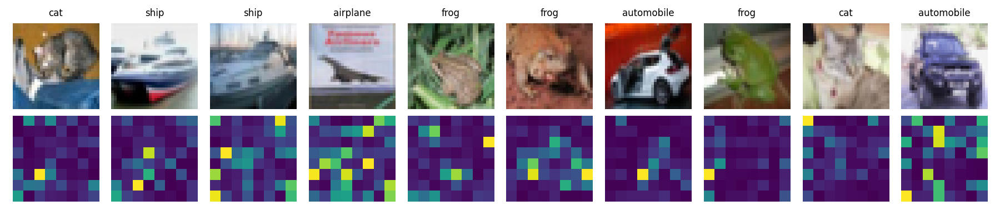
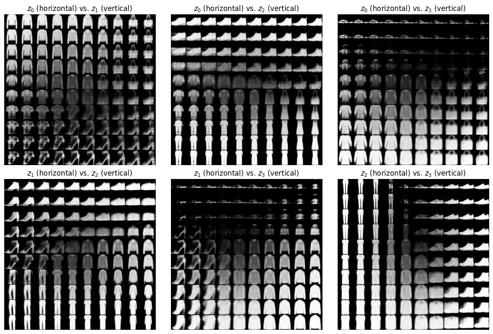
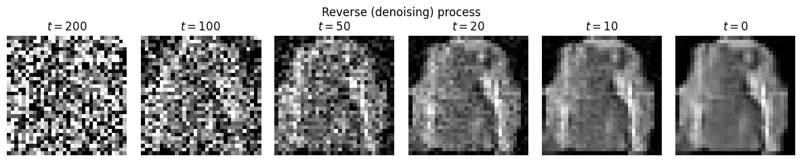

# Deep Learning Implementations in PyTorch

PyTorch implementations of transformers and deep generative models, written while self-studying
MIT 6.7960 [*Deep Learning*](https://ocw.mit.edu/courses/6-7960-deep-learning-fall-2024/) (Fall 2024).

> **Attribution.** These notebooks contain my solutions to course problem sets. The course provided the problem
> specifications and some implementation (parts of the training loops, the transformer's feed-forward/residual block, and
> the ViT wrapper). The diffusion U-Net comes from
> [`denoising-diffusion-pytorch`](https://github.com/lucidrains/denoising-diffusion-pytorch). Each notebook's
> introduction lists exactly which parts I implemented. Use of AI tools: I used ChatGPT and Claude in two ways. While working through the problem sets, I consulted them for coding and conceptual questions (with the goal of understanding implementations myself). When preparing this repository, I used them to clean up and restructure my notebooks.
>
> Course materials are © MIT OpenCourseWare, licensed under [CC BY-NC-SA 4.0](https://creativecommons.org/licenses/by-nc-sa/4.0/). 

| Notebook | What's inside |
|---|---|
| [`transformers.ipynb`](transformers.ipynb) | Attention, multi-head attention, and a transformer stack from scratch; a Vision Transformer on CIFAR-10; a word-level GPT on Tiny Shakespeare |
| [`vae_and_diffusion.ipynb`](vae_and_diffusion.ipynb) | A VAE with latent-space traversals and a DDPM diffusion model on Fashion-MNIST |

---

## 1. Transformers

**Implemented:** attention with masking, multi-head attention, the transformer stack, ViT patch embedding, a word-level tokenizer, GPT token/positional embeddings with a causal mask, and the next-token cross-entropy loss with padding masked out.

## 2. VAE and diffusion on Fashion-MNIST

**VAE** : implemented the reparameterization trick, the negative-ELBO loss (binary cross-entropy + closed-form Gaussian KL), and latent traversals. 

**DDPM** : implemented the closed-form forward noising process, the
noise-prediction objective, and the ancestral reverse sampler using the Gaussian posterior.

## References

- Vaswani et al., [*Attention Is All You Need*](https://arxiv.org/abs/1706.03762) (2017)
- Dosovitskiy et al., [*An Image Is Worth 16x16 Words*](https://arxiv.org/abs/2010.11929) (2020)
- Kingma & Welling, [*Auto-Encoding Variational Bayes*](https://arxiv.org/abs/1312.6114) (2013)
- Ho, Jain & Abbeel, [*Denoising Diffusion Probabilistic Models*](https://arxiv.org/abs/2006.11239) (2020)
- Tiny Shakespeare dataset from [karpathy/char-rnn](https://github.com/karpathy/char-rnn)
